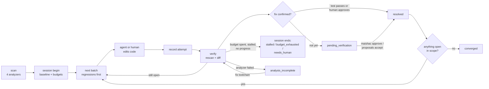
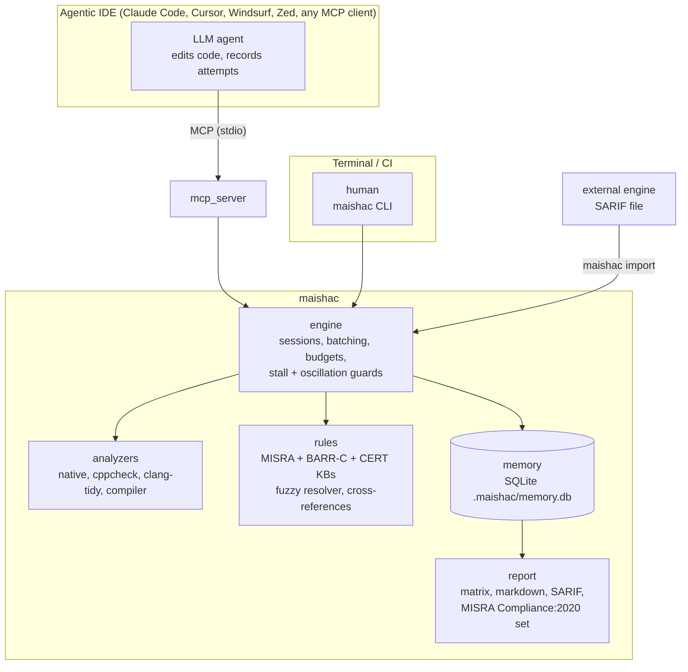

<p align="center"></p>

<p align="center">
  <a href="https://github.com/WinterLabsHQ/maisha/actions/workflows/ci.yml"></a>
  <a href="https://pypi.org/project/maishac/"></a>
  <a href="https://pypi.org/project/maishac/"></a>
  <a href="https://github.com/WinterLabsHQ/maisha/releases/latest"></a>
  <a href="LICENSE"></a>
</p>

<h1 align="center">Maisha</h1>

<p align="center"><b>An open-source compliance workflow for MISRA C:2012, BARR-C:2018 and CERT C,<br>driven from any agentic IDE.</b></p>

<p align="center">
  <a href="#-60-second-quick-start">Quick start</a> ·
  <a href="#-how-it-works">How it works</a> ·
  <a href="#-command-reference">Commands</a> ·
  <a href="#-use-it-from-your-ide-mcp">MCP setup</a> ·
  <a href="#-ci-gating">CI</a> ·
  <a href="#-scope-and-limitations">Limitations</a>
</p>

> [!WARNING]
> **Maisha is a workflow orchestrator and audit-trail layer, not a qualified or certified static-analysis tool.** Its findings do not by themselves satisfy tool-qualification requirements for DO-178C, ISO 26262 or IEC 62304, and running it is not a formal compliance certification. Use it *upstream* of a qualified engine. See [Scope and limitations](#-scope-and-limitations).

Searching for an open-source alternative to Polyspace, Helix QAC or Coverity for the MISRA C *workflow*? Maisha provides the fix loop, verification gate, deviation and audit-evidence handling, and author-time guidance that those vendors now sell as agentic toolkits. It runs on free engines (cppcheck, clang-tidy, gcc/clang warnings and a native analyzer) or sits on top of a qualified engine you already own, through SARIF. It is not a qualified detection engine and does not pretend to be. See [How Maisha compares](COMPARISON.md).

> *Maisha* is Swahili for **"life."** MISRA and CERT C exist because this is the software that flies planes, drives cars and runs medical devices. The CLI and package are `maishac` (*Maisha-for-C*).

## Contents

- [Why Maisha](#-why-maisha)
- [60-second quick start](#-60-second-quick-start)
- [How it works](#-how-it-works)
- [Features](#-features)
- [Command reference](#-command-reference)
- [Use it from your IDE (MCP)](#-use-it-from-your-ide-mcp)
- [CI gating](#-ci-gating)
- [The verification gate and trust model](#-the-verification-gate-and-trust-model)
- [Reading the reports](#-reading-the-reports)
- [Example output](#-example-output)
- [Rule coverage](#-rule-coverage)
- [Scope and limitations](#-scope-and-limitations)
- [Install options](#-install-options)
- [Documentation map](#-documentation-map)
- [Development and contributing](#-development-and-contributing)
- [License and disclaimer](#-license-and-disclaimer)

## 🎯 Why Maisha

An LLM agent can edit C code quickly, but it should not be the one deciding whether the code is compliant. Maisha is the deterministic half of that workflow: everything that must never hallucinate.

| Problem with agent-driven compliance | What Maisha does |
|---|---|
| Line numbers shift, so history is lost | Findings have stable fingerprints: `sha1(rule + file + normalized line + enclosing function)` |
| The analyzer that missed a bug also judges the fix | Fixes enter `pending_verification` and need a test run or a human sign-off |
| An agent can approve its own work | MCP sign-offs are only *proposals*; a person finalizes them with `maishac proposals` |
| A crashed or missing analyzer looks like a clean scan | A failed analyzer clears nothing; reports say `Not checked`, never "compliant" |
| Agents loop forever on the same finding | Iteration budgets, stall detection and oscillation freezing end every session in a defined state |
| Auditors want evidence | Append-only audit log, deviation register, SARIF 2.1.0 and the MISRA Compliance:2020 document set |

## ⚡ 60-second quick start

Requires Python 3.10+.

```bash
pipx install maishac              # or: pip install maishac
cd your-firmware-project

maishac doctor                    # which analyzers and rules are active on this machine?
maishac scan src/                 # scan and sync project memory (.maishac/memory.db)
maishac findings --limit 20       # ranked open findings
maishac rule "MISRA 21.3"         # explain a rule, with cross-standard references
```

Headers outside the scanned paths cause false positives in cppcheck and clang-tidy, so forward them with `--include`/`-I` (repeatable):

```bash
maishac scan src/ --include include/ --include vendor/sdk/inc
```

Then start an engineered fix session:

```bash
maishac session begin src/ --verification-policy human_gated   # prints a session_id
maishac session batch <id>        # next prioritized batch, with briefings
# ...you or your agent edit code...
maishac session verify <id>       # rescan, diff, grade attempts, run the gate
maishac approve <fingerprint> --by lead@example.com            # human sign-off
maishac session status <id>
```

> [!NOTE]
> Scan, gate, reports and sessions need **no third-party packages**. The MCP server is an optional extra: `pip install 'maishac[mcp]'`. cppcheck and clang-tidy are optional too; Maisha skips any analyzer that is not on `PATH` and tells you so.

## 🔁 How it works

### The fix loop



### Architecture



Design principles:

1. **Determinism where it matters.** Prioritization, verification, memory and budgets are code, not prompts.
2. **Findings are identities, not line numbers.** History stays attached to the defect through refactors.
3. **The loop must terminate.** Budgets, stall limits and oscillation freezing guarantee a defined end state.
4. **Compliance is a process, not a scan.** Deviations and suppressions are first-class, auditable records.

## ✨ Features

| Area | What you get |
|---|---|
| **Four analyzers** | `native` (zero dependencies), `cppcheck` (MISRA addon), `clang-tidy` (`cert-*` checks), `compiler` (gcc/clang warnings). Findings that hit the same defect are fingerprint-merged into one (`analyzer: native+cppcheck`). |
| **Explicit analyzer outcomes** | A crashed, timed-out or missing analyzer is a failed *analysis*. It clears nothing, and the scan reports `analyzer_errors` and a `coverage_warning`. A session whose rescan was partial ends `analysis_incomplete`. |
| **Author-time guidance** | `maishac guide "<topic>"` returns the idiom to prefer, the anti-pattern to avoid, why, and the rules it satisfies. `maishac check` lints a draft in memory before it is written. Protocol: [AUTHORING_PLAYBOOK.md](AUTHORING_PLAYBOOK.md). |
| **Persistent memory** | SQLite per project: finding lifecycle (open, resolved, regressed), every fix attempt and its outcome, suppressions, deviations with justification, approver and expiry, notes, scans. |
| **Engineered fix loop** | Severity-ranked, file-grouped batches. Regressions jump the queue. Each briefing carries the rule summary, a fix hint, strategies that already failed, memory notes and cross-standard equivalents. |
| **Verification gate** | A fix is not `resolved` because a warning stopped firing. See [the gate](#-the-verification-gate-and-trust-model). |
| **Sign-off integrity** | Agents propose, humans decide. Mandatory MISRA guidelines can never be suppressed or deviated. Append-only audit log and CLI-only revocation. |
| **Honest reporting** | `Not checked` status, `NOT ASSESSED` and `NO VIOLATIONS FOUND IN CHECKED GUIDELINES (N unchecked)` verdicts, a `scans` table and last-scan section. See [Reading the reports](#-reading-the-reports). |
| **MISRA Compliance:2020 evidence** | Guideline Compliance Summary, Guideline Enforcement Plan (lists only tools that actually check a guideline) and Guideline Re-categorization Plan, with legality rules enforced. |
| **SARIF in and out** | Export SARIF 2.1.0 with `partialFingerprints`. Import a qualified engine's SARIF (Helix QAC, Coverity and others), including `codeFlows` and `suppressions`, and run the same loop on it. |
| **CI gate** | `maishac scan --fail-on <severity\|any\|none>` and `maishac gate`, with exit codes 0, 1 and 2. |

<details>
<summary><b>SARIF import details</b></summary>

Qualified engines rarely put the MISRA/CERT number in `ruleId`. Helix QAC and Coverity emit a checker-specific id (for example `ABV.GENERAL`), reference the rule by `ruleIndex`, and attach the guideline through `relationships` into a `taxonomies` component. The importer resolves the rule through `result.rule`, `ruleIndex` and `ruleId`, follows relationships, taxonomies and result-level `taxa`, honors `defaultConfiguration` levels, skips non-defect results (`kind: pass`, `notApplicable`) and baseline-`absent` findings, tolerates missing regions and multi-location results, and normalizes scheme-prefixed URIs.

Import is not lossy. `codeFlows` (the data-flow path to the defect) appear in the agent briefing, and `result.suppressions` are honored so an existing triage baseline carries over. Export emits cross-standard equivalences as `reportingDescriptor.relationships`, and `startColumn` plus code flows survive an import and export round trip. Imported findings are never cleared by a native rescan. Suppressions inside a SARIF file are not carried over when an agent starts the import; run `maishac import` yourself.

</details>

## 🧰 Command reference

Run `maishac <command> --help` for every flag. Global option: `--project/-p` (project root, default: current directory).

| Command | Purpose |
|---|---|
| `doctor` | Diagnose install, analyzer toolchain, rule coverage on this machine, and project memory |
| `scan <paths>` | Scan and sync memory. Options below |
| `gate <paths>` | CI gate; alias of `scan --fail-on any` |
| `findings` | List ranked open findings (`--limit`) |
| `rule <id>` | Explain a rule, with cross-standard references |
| `guide <topic>` | Author-time guidance: the compliant idiom to use before writing code |
| `check` | Lint a draft snippet in memory from a file or stdin; nothing is stored |
| `session begin\|batch\|verify\|status\|abort` | Engineered fix-loop sessions |
| `approve <fingerprint> --by <who>` | Human sign-off on a `pending_verification` finding |
| `deviate`, `suppress`, `recategorize` | Record a deviation, a false-positive suppression, or a GRP re-categorization |
| `revoke-deviation`, `unsuppress`, `uncategorize` | Revocations (CLI-only, audited) |
| `proposals list\|accept\|reject` | Review sign-offs an MCP agent proposed |
| `audit` | Append-only history of sign-offs and sessions (`--json`, `--action`) |
| `note` | Persist a project convention note |
| `import <file.sarif>` | Import findings from an external engine |
| `report --format ...` | `markdown`, `json`, `sarif`, `misra-compliance` (GCS), `gep`, `grp` |
| `serve` | Run the MCP server over stdio (needs the `mcp` extra) |

<details>
<summary><b>Scan options</b></summary>

| Option | Meaning |
|---|---|
| `--analyzers a,b` | Comma list from `native,cppcheck,clang-tidy,compiler` |
| `--include/-I DIR` | Include directory forwarded to cppcheck, clang-tidy and the compiler (repeatable) |
| `--exclude PATTERN` | fnmatch pattern of directories/files to skip (repeatable), added to the defaults (`.git`, `.maishac`, `build`, `dist`, `node_modules`, ...) |
| `--no-default-excludes` | Do not skip the default directories |
| `--std STD` | C standard for compiler and clang-tidy checks (default `c11`) |
| `--compiler-flag FLAG` | Extra flag such as `-DNDEBUG` or `-Iinc` (repeatable; only `-D/-U/-I/-isystem/-iquote/-std=` and a few target flags are accepted) |
| `--compile-commands FILE` | Take per-file `-D/-I/-std` flags from a `compile_commands.json` |
| `--fail-on SEVERITY` | CI gate: `blocker\|critical\|major\|minor\|info\|any\|none` |
| `--allow-degraded` | With `--fail-on`: do not exit 2 for a degraded analysis |

`session begin` accepts the same scan options plus `--max-iterations`, `--batch-size`, `--severity-floor`, `--verification-policy`, `--test-command`, `--test-timeout` and `--force`. `session abort` takes `--reason` and `--by`.

</details>

<details>
<summary><b>Recording decisions: deviations, suppressions, re-categorization, notes</b></summary>

```bash
maishac deviate "MISRA 19.2" --scope "drivers/**" \
    --justification "Union required for hardware register overlay mapping" \
    --approver lead@example.com --expires 2027-01-01
maishac suppress <fingerprint> --reason "false positive: macro expansion" --approver lead@example.com
maishac recategorize "MISRA 15.1" --to disapplied \
    --rationale "No goto in this codebase; disapplied by acquirer/supplier agreement" \
    --approver lead@example.com
maishac note "This codebase uses FreeRTOS; heap_4 allocator is approved" --tags misra-21.3

# revocations stay in the audit log
maishac unsuppress <fingerprint> --by lead@example.com
maishac revoke-deviation <deviation-id> --by lead@example.com
maishac uncategorize "MISRA 15.1" --by lead@example.com

maishac report --format sarif > compliance.sarif
maishac report --format misra-compliance > gcs.md   # Guideline Compliance Summary
maishac report --format gep > gep.md                # Guideline Enforcement Plan
maishac report --format grp > grp.md                # Guideline Re-categorization Plan
```

A deviation needs a justification of at least 15 characters and a suppression a reason of at least 10. Recategorization legality is enforced: a Mandatory guideline cannot be re-categorized, and a Required one cannot drop to Advisory or Disapplied. An expired deviation permit no longer counts.

</details>

<details>
<summary><b>Session states</b></summary>

| State | Meaning |
|---|---|
| `active` | In progress |
| `awaiting_verification` | Fixes are pending a test run or human sign-off |
| `converged` | Nothing open in scope (imported findings do not block) |
| `stalled` / `budget_exhausted` | No progress over the stall window / iteration budget spent |
| `needs_human` | Every remaining finding is frozen by the oscillation guard (a finding that regresses twice) |
| `analysis_incomplete` | The rescan could not run every analyzer, so "nothing left" cannot be concluded. Not terminal: fix the toolchain and `session verify` again |
| `aborted` | Ended on purpose with `maishac session abort <id>` |

Ended sessions refuse `next_batch`, `verify` and `record_attempt`. `verify` respects the session's `--severity-floor` and paths; findings outside them are reported as `open_out_of_scope`. `session begin` refuses to start while another session is active on the project unless you pass `--force`.

</details>

## 🔌 Use it from your IDE (MCP)

Install the extra, then add the server to your IDE's MCP configuration:

```bash
pipx install 'maishac[mcp]'      # or: pip install 'maishac[mcp]'
```

```json
{
  "mcpServers": {
    "maisha": {
      "command": "maishac",
      "args": ["serve"],
      "env": { "MAISHAC_PROJECT": "/absolute/path/to/your/project" }
    }
  }
}
```

Ready-made files are in [`integrations/`](integrations/): [`claude-code.mcp.json`](integrations/claude-code.mcp.json), [`cursor.mcp.json`](integrations/cursor.mcp.json) (uses `${workspaceFolder}`) and [`generic-mcp.json`](integrations/generic-mcp.json). The extra pins `mcp>=1.2.0,<2`; without it, `maishac serve` exits with an install hint. Then tell your agent something like:

> Begin a Maisha compliance session on `src/`, work through batches until converged, record every attempt, and propose deviations only where a fix is genuinely impossible.

The recommended agent protocol is in [AGENT_PLAYBOOK.md](AGENT_PLAYBOOK.md).

<details>
<summary><b>MCP tools</b></summary>

| Tool | Purpose |
|---|---|
| `compliance_scan` | Scan paths, merge analyzers, sync memory, return the diff |
| `compliance_list_findings` / `compliance_get_finding` | Ranked open findings / full briefing for one fingerprint |
| `compliance_explain_rule` / `compliance_search_rules` | Rule summary and cross-references / keyword search |
| `compliance_guidance` | Before writing code: the compliant idiom for a concern |
| `compliance_check_snippet` | Lint a draft in memory, before it is written; stores nothing |
| `compliance_doctor` | Toolchain and coverage diagnosis |
| `compliance_begin_session` / `compliance_next_batch` | Baseline scan with budgets / next prioritized batch |
| `compliance_record_attempt` | Log the strategy used on a finding (auto-graded on verify) |
| `compliance_verify` | Rescan, diff, grade attempts, run the gate, advance the state machine |
| `compliance_session_status` / `compliance_abort_session` | Progress and state / end a session |
| `compliance_approve_finding` | **Proposes** a human sign-off for a `pending_verification` finding |
| `compliance_add_deviation` | **Proposes** a deviation (never for Mandatory guidelines) |
| `compliance_recategorize` | **Proposes** a GRP re-categorization |
| `compliance_suppress_finding` | **Proposes** a false-positive suppression (never for Mandatory guidelines) |
| `compliance_list_proposals` | Proposals still waiting for a human |
| `compliance_import_sarif` | Ingest an external engine's SARIF into the same loop |
| `compliance_report` | Markdown, JSON, SARIF, or the MISRA Compliance:2020 set (`misra-compliance`, `gep`, `grp`) |
| `memory_note` / `memory_search` / `memory_stats` | Project convention memory |

Nothing in the MCP surface can revoke a sign-off or set the test command.

</details>

## 🚦 CI gating

`maishac scan` exits 0 by default, whatever it finds. To fail a pipeline, ask for it:

```bash
maishac scan src/ --fail-on major     # blocker|critical|major|minor|info|any|none
maishac gate src/                     # alias of: scan --fail-on any
maishac scan src/ --fail-on any --allow-degraded
```

| Exit | Meaning |
|---|---|
| `0` | No open finding at or above the threshold, and the analysis was complete |
| `1` | Open findings at or above `--fail-on`. Also any CLI error, such as an unknown session id, a bad argument or a zero-file scan |
| `2` | The analysis was **degraded** (an analyzer failed, or a recommended one is not installed) and `--allow-degraded` was not given |

Findings take precedence over degradation (exit 1 beats 2). A degraded pass is not a pass: a clean result from a scan that never ran cppcheck says nothing about the rules cppcheck covers. The scan JSON carries `open_by_severity` and, with the flag, a `gate` block.

<details>
<summary><b>GitHub Actions example</b></summary>

```yaml
name: misra
on: [pull_request]
jobs:
  maisha:
    runs-on: ubuntu-latest
    steps:
      - uses: actions/checkout@v4
      - uses: actions/setup-python@v5
        with: { python-version: "3.12" }
      - run: sudo apt-get install -y cppcheck clang-tidy
      - run: pip install maishac
      - run: maishac scan src/ --include include/ --fail-on major
      - run: maishac report --format sarif > maisha.sarif
        if: always()
      - uses: github/codeql-action/upload-sarif@v3
        if: always()
        with: { sarif_file: maisha.sarif }
```

Or use the container, which has cppcheck's MISRA addon and clang-tidy baked in:

```bash
docker run --rm -v "$PWD:/work" ghcr.io/winterlabshq/maisha scan src/ --fail-on major
```

</details>

## 🔒 The verification gate and trust model

**The trap.** The only judge of a fix is the analyzer whose blind spot may have created the finding. Casting a signed sentinel (`-1` meaning "no limit") to `uint32_t` to silence a signed/unsigned warning turns "no limit" into "an enormous limit". The rescan passes and no static check catches it.

So a fix goes to `pending_verification` and leaves only under the session's `verification_policy`:

| Policy | A pending fix becomes `resolved` when... |
|---|---|
| `analyzer_only` | the analyzer stops flagging it (not recommended for compliance work) |
| `test_gated` | the human-configured test command exits 0 |
| `human_gated` | a human approves it |

The default is `test_gated` if a test command is configured, else `human_gated`. Whatever the policy, **semantic-risk findings** (casts, comparisons, sign conversions, control-flow changes) and **high-severity findings** always need human approval. A file that vanishes from its path does not resolve its high-severity findings either.

> [!NOTE]
> The semantic-risk category list is broad, so `test_gated` sessions on typical MISRA findings need human sign-off almost as often as `human_gated` ones. In one simulated session a passing test suite auto-resolved none of eight pending findings; see [BENCHMARK-SUITE-REPORT.md §3.2](BENCHMARK-SUITE-REPORT.md#32-the-gate-is-more-conservative-than-it-looks). Budget review time accordingly.

### Agents propose, humans decide

| Rule | Detail |
|---|---|
| MCP sign-offs are proposals | `compliance_approve_finding`, `compliance_add_deviation`, `compliance_recategorize` and `compliance_suppress_finding` create a proposal (`pending_human`). Nothing changes until a person runs `maishac proposals accept <id> --by <who>` in a terminal and types the proposal id to confirm (or `reject <id> --by <who> -r "why"`). The accepting person is recorded as approver, with OS user and TTY state in the audit log. Scripts without a TTY need `--yes`, `MAISHAC_HUMAN=1` and `MAISHAC_CONFIRM_TOKEN` matching the token a person registered with `maishac proposals set-token`. |
| Over MCP, scans are gated | `analyzer_only` is refused, so an agent cannot resolve findings by editing code and rescanning. |
| Opt-out exists, and is unsafe | `MAISHAC_ALLOW_AGENT_APPROVALS=1` in the server's environment makes those tools act directly. The agent then grades its own work. Entries are stored with `source=mcp`, marked `[AGENT-ORIGINATED]` and flagged in reports. |
| Mandatory rules are protected | MISRA Mandatory guidelines (judged after GRP re-categorization) can never be suppressed or deviated, in any mode. |
| Revocation is human-only | `unsuppress`, `revoke-deviation` and `uncategorize` exist only in the CLI. |
| Everything is logged | Every sign-off, revocation, proposal decision and session start/end goes to an append-only `audit_log` (`maishac audit`). Agent-made actions are marked `[AGENT]`. |

**The test command is human-only.** It runs on your machine, so an MCP agent cannot set it. Configure it with `--test-command`, the `MAISHAC_TEST_COMMAND` environment variable, or `{"test_command": "make test", "test_timeout": 600}` in `.maishac/config.json` (first one found wins, in that order). It is split with `shlex` and run without a shell, so write `sh -c 'a && b'` if you need pipes. The default timeout is 600 s (`--test-timeout`, `MAISHAC_TEST_TIMEOUT`); on timeout the whole process group is killed.

> [!WARNING]
> `.maishac/config.json` is only human-controlled if the agent cannot write to the project directory. An agent with file-write access can edit that file and the `.maishac/` database directly. If that matters, run the agent in a sandbox that makes `.maishac/` read-only, or set the command with the flag or environment variable.

## 📋 Reading the reports

Reports are built from recorded evidence, including which analyzers actually succeeded in the last scan (stored in the `scans` table with their versions).

| Status / verdict | Meaning |
|---|---|
| `Violations`, `Deviations`, `Compliant`, `Disapplied` | Checked in the last scan, with that outcome. An expired deviation permit no longer counts |
| `Not checked` | No analyzer that maps to this guideline succeeded in the last recorded scan, no scan was recorded, or the guideline is reference-only. It says nothing about the code |
| `NOT ASSESSED` | No scan has been recorded |
| `NO VIOLATIONS FOUND IN CHECKED GUIDELINES (N unchecked)` | The only favourable verdict. Gets `; last scan degraded or incomplete` and/or `WITH DEVIATIONS` appended when applicable |
| `NON-COMPLIANT` / `PENDING` | Open violations (or a Mandatory violation or deviation) / fixes recorded but not yet verified |

The Guideline Enforcement Plan's `checked_by` lists only analyzers that map the guideline, with `(not installed)` when absent. Reference-only guidelines read "Not enforced by tooling - requires separate method". The compliance matrix reports `rules_in_kb`, `rules_detectable` and `clean_among_checked`. `report --format sarif` uses the real Maisha version, exports suppressed and deviated findings with SARIF `suppressions`, and includes the column.

> [!NOTE]
> **Upgrading:** `.maishac/memory.db` migrates in place the first time a new version opens it, and old fingerprints stay valid. A scan recorded by an older version has no `scans` row, so reports show `NOT ASSESSED` and `Not checked` until you run one new scan. See [CHANGELOG.md](CHANGELOG.md).

## 📟 Example output

Produced by running the CLI on [`examples/bad.c`](examples/bad.c), a deliberately non-compliant fixture. Counts depend on which analyzers are installed; this run used `native`, `clang-tidy` and `compiler` (no cppcheck).

```console
$ maishac findings --limit 5
[ blocker] CERT STR31-C                 bad.c:25  call to banned function 'strcpy' (unbounded copy)  (3021032318085a9c)
[ blocker] CERT STR31-C                 bad.c:26  call to banned function 'sprintf' (unbounded format)  (82c284b0036bfcc6)
[ blocker] CERT ENV33-C                 bad.c:44  call to banned function 'system' (command processor invocation)  (7c47a271bf9c0db2)
[critical] MISRA-C:2012 Rule 15.6       bad.c:14  control statement body is not a compound (braced) block  (217230e8a8e21358)
[critical] MISRA-C:2012 Rule 7.3        bad.c:15  lowercase 'l' literal suffix is easily misread as '1'  (8565f97307e5c748)
```

With cppcheck missing, `maishac scan` prints a coverage warning instead of implying a clean result:

```console
$ maishac scan bad.c
WARNING: Reduced coverage: 57/107 detectable rules active (53%).
  - cppcheck not installed (cppcheck): 50 rule(s) unchecked, e.g. CERT ARR30-C, CERT ARR32-C, CERT DCL30-C
A clean result here does NOT mean the code is compliant with the rules above - they were never checked. ...

$ maishac gate bad.c > /dev/null; echo $?
1
```

## 📊 Rule coverage

The three rule knowledge bases hold **214 rules** with original paraphrased summaries written for this project. No standard text is reproduced.

| Standard | Rules in KB | Enforced (an analyzer detects it) | Reference only |
|---|---:|---:|---:|
| MISRA C:2012 | 72 | 71 | 1 |
| BARR-C:2018 | 20 | 2 | 18 |
| CERT C | 122 | 34 | 88 |
| **Total** | **214** | **107** | **107** |

*Reference* entries are carried for cross-standard equivalence, deviation records and SARIF import. Maisha does not find them for you. On a machine with only the zero-dependency tools, `maishac doctor` reports how many enforced rules are reachable (57 of 107 with native, clang-tidy and gcc; installing cppcheck raises that). Every covered rule and the analyzer behind it is listed in [COVERAGE.md](COVERAGE.md), generated from the code so gaps are explicit.

## 🧭 Scope and limitations

**Maisha is** a workflow orchestrator for agent-driven triage and fix loops, a persistent audit-trail layer (including *how* every fix was confirmed and by whom), and a pre-certification cleanup tool for the IDE loop.

**Maisha is not:**

- **A qualified or certified analysis tool.** Its engines are cppcheck, clang-tidy, gcc/clang warnings and a native analyzer. None carries a tool qualification kit. DO-178C, ISO 26262 and IEC 62304 generally require the analysis tool itself to be qualified or proven in use.
- **Complete rule coverage.** 214 curated rules are a fraction of MISRA C:2012 (roughly 175 rules and directives with amendments; approximate, depends on the amendments adopted) or CERT C. Detection is bounded by the underlying engines, not by the curated set.
- **A source of "compliant".** A guideline no analyzer examined is `Not checked`. A failed or missing analyzer is a failed analysis, not a clean one.
- **A substitute for human review.** A clean rescan alone never resolves a fix by default, and semantic-risk and high-severity findings always need a person. Snippet checks (`maishac check`) cover the lexical subset only; a clean snippet is not a compliance guarantee.

**Recommended for certification pipelines:** run Maisha for early, agent-driven cleanup, then hand off to a qualified engine (Astrée, Polyspace, Helix QAC, Parasoft C/C++test, IAR C-STAT) for the evidence an auditor accepts. Those engines emit SARIF, and `maishac import findings.sarif` layers Maisha's loop, memory, gate and deviation register on top of their findings.

Measured accuracy: a run against the FreeRTOS kernel, with a measured false-positive rate and the tool bugs it surfaced, is in [BENCHMARKS.md](BENCHMARKS.md). Its main lesson is to pass your include paths with `--include`/`-I`. A ground-truthed accuracy and reliability suite is in [BENCHMARK-SUITE-REPORT.md](BENCHMARK-SUITE-REPORT.md).

## 📦 Install options

```bash
pipx install maishac                 # isolated CLI (recommended)
pip install maishac                  # or into the current environment
pipx install 'maishac[mcp]'          # plus the MCP server
```

Optional external analyzers widen coverage. Native always works; anything not on `PATH` is skipped, and `analyzers_used` in the scan output shows what ran.

```bash
apt install cppcheck clang-tidy      # Debian/Ubuntu
pip install cppcheck clang-tidy      # no root needed; prebuilt wheels, incl. Windows and macOS
```

**Container** (cppcheck's MISRA addon and clang-tidy baked in):

```bash
docker run --rm -v "$PWD:/work" ghcr.io/winterlabshq/maisha scan src/
docker run --rm -i ghcr.io/winterlabshq/maisha serve      # MCP server over stdio
```

Full setup, including editor wiring: [INSTALL.md](INSTALL.md).

**Project state.** Memory lives in `.maishac/memory.db` (SQLite, WAL mode with a busy timeout, so a CI scan and a local session can coexist). It is local, machine-specific state: add `.maishac/` to `.gitignore` and share results by exporting a report, not the database.

## 📚 Documentation map

| Document | Contents |
|---|---|
| [INSTALL.md](INSTALL.md) | Full setup, analyzers, MCP wiring per editor, CI, troubleshooting |
| [AGENT_PLAYBOOK.md](AGENT_PLAYBOOK.md) | Protocol to hand your IDE agent for the fix loop |
| [AUTHORING_PLAYBOOK.md](AUTHORING_PLAYBOOK.md) | Guidance, draft, check, rewrite protocol |
| [COVERAGE.md](COVERAGE.md) | Every rule and the analyzer that detects it |
| [COMPARISON.md](COMPARISON.md) | How Maisha compares with commercial tools |
| [SECURITY.md](SECURITY.md) | Supported versions and vulnerability reporting |
| [BENCHMARKS.md](BENCHMARKS.md), [BENCHMARK-SUITE-REPORT.md](BENCHMARK-SUITE-REPORT.md), [VALIDATION.md](VALIDATION.md) | Measured accuracy and validation |
| [CHANGELOG.md](CHANGELOG.md) | Release history and behaviour changes |
| [CONTRIBUTING.md](CONTRIBUTING.md), [CODE_OF_CONDUCT.md](CODE_OF_CONDUCT.md) | Contributing |

## 🤝 Development and contributing

```bash
git clone https://github.com/WinterLabsHQ/maisha.git && cd maisha
pip install -e ".[dev,mcp]"          # editable install with pytest and the MCP server
python -m pytest tests/ -q           # MCP tests skip if the mcp extra is absent
```

Contributions are welcome, especially to the community-extensible parts: a coding-standard **rule**, an authoring **pattern** (compliant idiom), or an **analyzer adapter** or SARIF-dialect mapping. None of these touch the engine. See [CONTRIBUTING.md](CONTRIBUTING.md) for the how-to and the design invariants, and [CODE_OF_CONDUCT.md](CODE_OF_CONDUCT.md). Good first issues are labeled on the tracker.

## 📄 License and disclaimer

Released under the [MIT License](LICENSE). Rule summaries are independent restatements written for this project, not reproductions of any standard's text. Rule identifiers and categories are facts used to reference the guidelines; the wording is ours. For authoritative wording you need the official MISRA, BARR and SEI CERT documents.

MISRA® is a registered trademark of The MISRA Consortium Limited. BARR-C:2018 is copyright Barr Group (Integrated Embedded, LLC) and is named here as the source of those rule identifiers, as the standard invites tools that detect violations to do. SEI CERT® is a registered trademark of Carnegie Mellon University. None of these organisations endorse or are affiliated with Maisha. Maisha output does not constitute a formal compliance certification.
